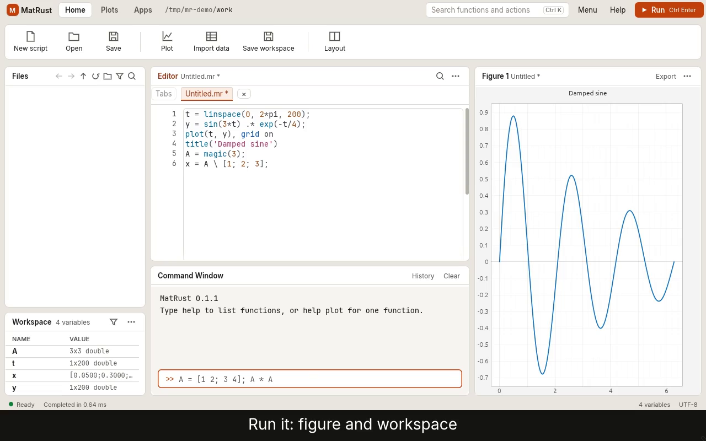

# MatRust

MatRust is a numerical engine written in Rust that runs a subset of the MATLAB language, with an optional native desktop workspace (Command Window, Editor, Workspace, Figures). It is not MATLAB and is not affiliated with MathWorks.

Alpha. Expect gaps.

[](https://matrust.dev/media/demo.mp4)

One-minute demo (MP4, 0.6 MB, no sound). Try it in your browser at [matrust.dev/try](https://matrust.dev/try/).

## What works

- Language: scripts, functions in `.m` or `.mr` files, control flow, structs, cells, function handles, `try/catch` and `switch`.
- Numeric types: double, single, `int8` to `uint64`, logical, char and complex.
- Over 750 functions have a help page (`help <name>` or `assets/help/functions.md`). Each page states how the function differs from MATLAB.
- Plotting, with figure export to image and vector formats.
- MAT files and CSV files (`save`, `load`, `readmatrix`, `writematrix`).
- A Filter Designer and a discrete-time Block Simulation tool in the desktop app.
- The command-line program `matrust` uses the same engine as the desktop app.

## What does not work yet

- Toolboxes.
- Simulink. The block tool is small and discrete-time only.
- Object-oriented MATLAB (`classdef`). `containers.Map` is available.
- N-dimensional arrays and sparse matrices.
- Many option flags. Calls outside a function's stated limits are rejected with an error, not approximated.
- Very long or very large runs. Per-run limits on execution steps, output size, figures and series stop them with an error (see the user guide).

## Download

Release archives for Windows x64, Linux x64 and macOS are on the
[GitHub Releases page](https://github.com/leoom-labs/matrust/releases).
The Linux build needs glibc 2.35 or newer (Ubuntu 22.04, Debian 12, Fedora 36 and later); it also comes as a single-file AppImage.
The macOS build is unsigned: the first time, right-click `matrust-desktop` in Finder and choose Open.

Or install with a package manager (no Gatekeeper or SmartScreen prompt):

```sh
brew install leoom-labs/tap/matrust          # macOS (Apple silicon), Linux
```

```powershell
scoop bucket add matrust https://github.com/leoom-labs/scoop-bucket
scoop install matrust                        # Windows
```

Each archive contains:

- `matrust-desktop`: the desktop workspace.
- `matrust`: the command-line program.
- `matrust-pdf-worker`: a helper. Keep it in the same folder as the other two.

## Quick example

Paste this into the Command Window or save it as a script:

```matlab
A = magic(4);
b = [1; 2; 3; 4];
x = A(1:3,1:3) \ b(1:3);
disp(x)
t = linspace(0, 2*pi, 100);
plot(t, sin(t))
xlabel('t')
grid on
```

From a shell:

```
matrust --eval "disp(magic(3))"
```

## Build from source

Built and tested with Rust 1.99; older versions are untested. `Cargo.lock` pins the dependencies.

Linux, with the desktop app:

```
cargo build --release --features desktop
```

This needs the usual X11 or Wayland development libraries, CMake and a C compiler (HDF5 is built statically).

Command line only:

```
cargo build --release
```

Windows:

```
scripts\install-build-tools.ps1
scripts\build.ps1 -Desktop
```

For the smaller download-size profile:

```
cargo build --profile dist --features desktop
```

## Benchmarks

`matrust bench` times MatRust on a built-in suite or on your own cases and scripts.
`matrust bench --share` prints MatRust's numbers for a public GitHub issue that you submit yourself; MatRust sends nothing.
Method and commands: [BENCHMARKS.md](BENCHMARKS.md). What is shared: [docs/privacy.md](docs/privacy.md).

## Documentation

Start with the user guide. It covers the desktop windows, the command line, file formats and the limits you will meet.

- [User guide](docs/guide/user-guide.md)
- In the app or the command line: `help <name>`
- [Contributing](CONTRIBUTING.md)

## License

MatRust is free software under the GNU General Public License, version 3 or later (`LICENSE`): you may use, change and share it, and anyone who distributes a changed version or a program built on it must publish that source under the same licence. The fonts Inter and JetBrains Mono are under the SIL Open Font License 1.1 (`assets/fonts`). Each release archive includes the third-party notices in `THIRD-PARTY-LICENSES.txt`.

MATLAB is a registered trademark of The MathWorks, Inc. MatRust is not affiliated with, endorsed by, or sponsored by MathWorks.
